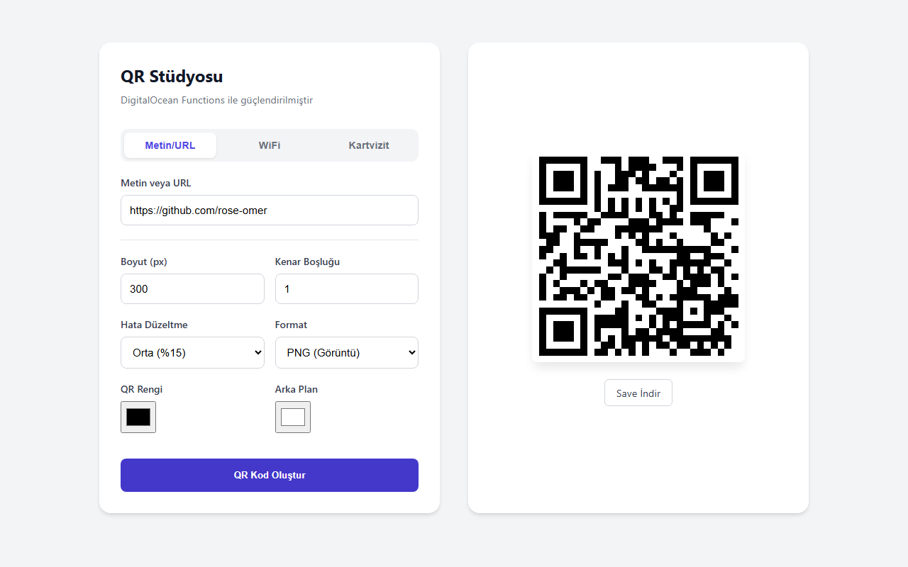
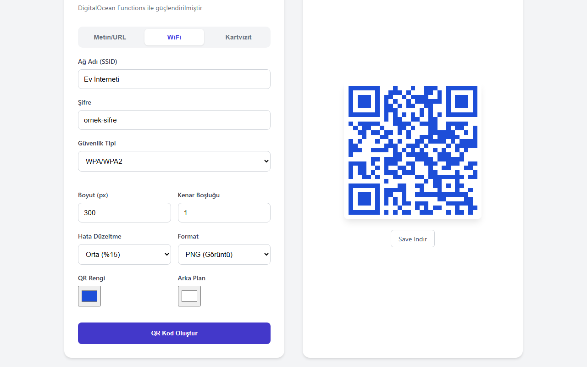
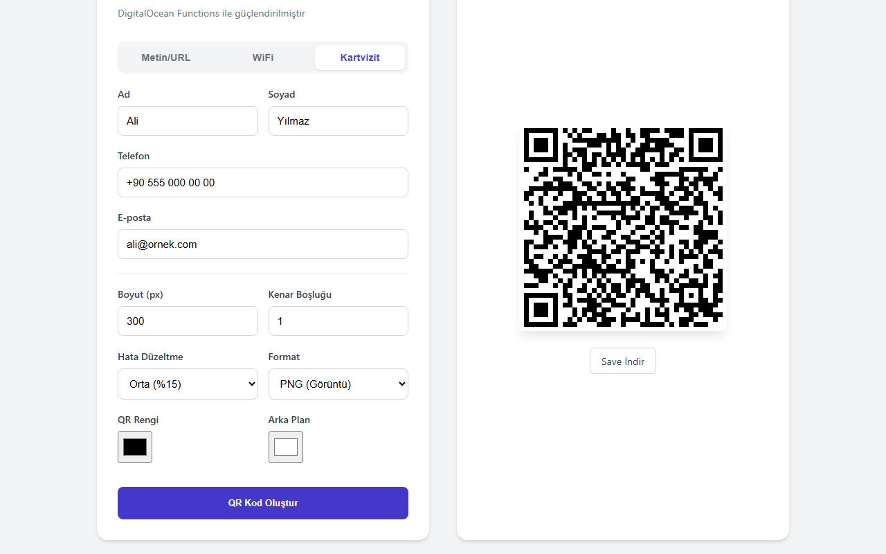
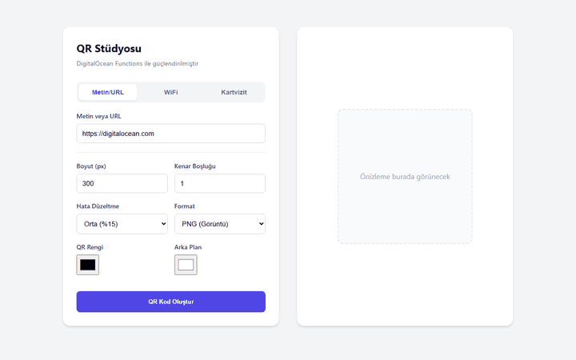

# Advanced QR Code Generator - DigitalOcean Functions

DigitalOcean Functions üzerinde çalışan, zengin özelliklere sahip, modern bir Serverless QR Kod Oluşturucu.

## Özellikler

*   **Gelişmiş Formatlar:** PNG (Base64) ve SVG (Vektörel) çıktı desteği.
*   **Tam Özelleştirme:** Boyut, renk ve arka plan rengi ayarları.
*   **Hata Düzeltme:** Yıpranmış QR kodların okunabilmesi için L, M, Q, H seviyeleri.
*   **Kenar Boşluğu:** QR kod çevresindeki beyaz alanı (margin) ayarlama.
*   **Hazır Şablonlar:** WiFi paylaşımı ve Kartvizit (vCard) oluşturma desteği.
*   **Test Arayüzü:** Kullanıcı dostu HTML5 arayüzü ile tarayıcıdan kolay kullanım.

---

## Ekran görüntüleri

`test.html` arayüzü (QR Stüdyosu):

| Metin / URL | WiFi | Kartvizit |
|---|---|---|
|  |  |  |

## Kullanım



1. Fonksiyonu deploy edin; `test.html` içindeki `FUNCTION_URL` değerine fonksiyon adresini yazın.
2. `test.html` dosyasını açın. **Metin/URL**, **WiFi** ya da **Kartvizit** sekmesini seçin.
3. Boyut, kenar boşluğu, hata düzeltme, format (PNG/SVG) ve renkleri ayarlayın.
4. **QR Kod Oluştur** deyin; sonuç sağda görünür ve indirilebilir.

Görseller fonksiyonun yerelde çağrılmasıyla alındı (`packages/qr/qr-generator/index.js`).

## Kurulum ve Deploy

Bu projeyi DigitalOcean üzerinde çalıştırmanın en kolay iki yolu:

### Yöntem 1: App Platform (Önerilen)
1. Bu projeyi GitHub hesabınıza fork'layın veya yükleyin.
2. [DigitalOcean App Platform](https://cloud.digitalocean.com/apps) sayfasına gidin.
3. **Create App** -> **GitHub** seçeneği ile reponuzu bağlayın.
4. DigitalOcean projeyi `Functions` olarak otomatik algılayacaktır.
5. **Next** diyerek ilerleyin ve **Create Resources** butonuna basın.
6. Deploy bittiğinde size verilen URL'i (örn: `https://...ondigitalocean.app`) kullanmaya başlayabilirsiniz.

### Yöntem 2: CLI (doctl)
Bilgisayarınızda `doctl` yüklü ise:

```bash
# DigitalOcean'a bağlan
doctl auth init

# Serverless eklentisini kur
doctl serverless install

# Projeyi deploy et
doctl serverless deploy . --remote-build
```

---

## Kullanım ve API Dokümantasyonu

Fonksiyonunuz deploy edildikten sonra `/qr/qr-generator` endpoint'ine `POST` istekleri atarak kullanabilirsiniz.

**Endpoint:** `https://<APP-URL>/qr/qr-generator`

### Parametreler (JSON Body)

| Parametre | Tip | Varsayılan | Açıklama |
|-----------|-----|------------|----------|
| `text` | string | **Zorunlu** | QR koda çevrilecek metin veya veri. |
| `size` | number | `300` | QR kodun piksel cinsinden boyutu (100-1000 arası). |
| `margin` | number | `1` | Kenar boşluğu kalınlığı (blok sayısı). |
| `errorCorrectionLevel` | string | `'M'` | Hata düzeltme seviyesi: `'L'`, `'M'`, `'Q'`, `'H'`. |
| `format` | string | `'base64'` | Çıktı formatı: `'base64'` (resim), `'svg'` (vektör). |
| `color` | hex | `'#000000'` | QR kod rengi (Örn: `#FF0000`). |
| `background` | hex | `'#FFFFFF'` | Arka plan rengi. |

### Örnek İstekler

#### 1. Basit URL (cURL)
```bash
curl -X POST "https://<APP-URL>/qr/qr-generator" \
  -H "Content-Type: application/json" \
  -d
  {
    "text": "https://digitalocean.com",
    "size": 400
  }
```

#### 2. WiFi Paylaşımı
```bash
curl -X POST "https://<APP-URL>/qr/qr-generator" \
  -H "Content-Type: application/json" \
  -d
  {
    "text": "WIFI:S:EvInternetim;T:WPA;P:gizlisifre;;",
    "errorCorrectionLevel": "H",
    "color": "#4F46E5"
  }
```

#### 3. JavaScript (Fetch)
```javascript
const response = await fetch('https://<APP-URL>/qr/qr-generator', {
  method: 'POST',
  headers: { 'Content-Type': 'application/json' },
  body: JSON.stringify({
    text: 'Merhaba!',
    format: 'svg',
    margin: 2
  })
});
const svgData = await response.text();
```

---

## Test ve Geliştirme

### Tarayıcı Arayüzü (`test.html`)
Proje içinde gelen `test.html` dosyası, API'yi denemeniz için modern bir arayüz sunar.
1. `test.html` dosyasını bir metin editörüyle açın.
2. `FUNCTION_URL` satırını kendi deploy ettiğiniz URL ile güncelleyin.
3. Dosyayı tarayıcınızda açın.

### Python Test Aracı
Terminal üzerinden test etmek için:
```bash
python3 send_qr_request.py
```

### Yerel Geliştirme (Localhost)
Fonksiyonu kendi bilgisayarınızda simüle etmek için:
```bash
npm start
# Veya
node test-server.js
```
Bu komut `http://localhost:3000` adresinde basit bir sunucu başlatır.

---

## Proje Yapısı

```
.
├── packages/qr/qr-generator/  # Fonksiyon kaynak kodları
│   ├── index.js               # Ana fonksiyon mantığı
│   └── package.json           # Fonksiyon bağımlılıkları
├── test.html                  # Kullanıcı arayüzü (Frontend)
├── project.yml                # DigitalOcean yapılandırma dosyası
└── README.md                  # Dokümantasyon
```

## Teknolojik Altyapı

Proje, modern **Serverless (Sunucusuz)** mimari üzerine inşa edilmiştir.

*   **Platform:** DigitalOcean Functions
*   **Dil:** Node.js 18 (JavaScript)
*   **Çekirdek Kütüphane:** `node-qrcode` - Metinleri QR matrisine dönüştüren motor.
*   **Mimari:**
    *   **Stateless (Durumsuz):** Sunucu sürekli açık değildir. Sadece istek geldiğinde fonksiyon çalışır, işini yapar ve kapanır. Bu sayede kaynak tüketimi ve maliyet minimumdur.
    *   **Event-Driven:** HTTP istekleri (tetikleyiciler) ile çalışır.
*   **İşleyiş:** Backend, gelen JSON isteğindeki parametreleri (`text`, `size`, `color` vb.) işler, `qrcode` kütüphanesi ile görseli oluşturur ve istemciye uygun formatta (`base64`, `svg` veya `png`) yanıt döner.

## Lisans
Bu proje eğitim amaçlıdır ve özgürce kullanılabilir.